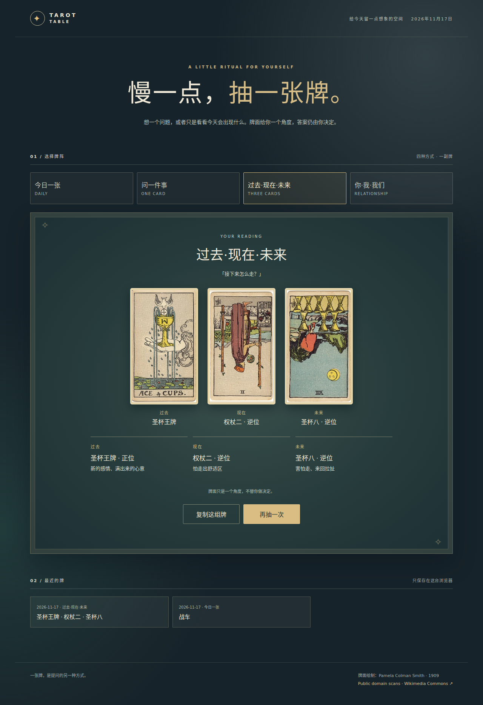

# Tarot Table · 一张牌

一个可以单独运行的塔罗抽牌网页：78 张牌、四种牌阵、逐张翻牌，以及仅保存在当前浏览器的记录。无需账号、后端或面板接口。



## 使用

在仓库目录启动任意静态文件服务器，例如：

```bash
python3 -m http.server 8000
```

然后打开 `http://localhost:8000`。页面不能直接通过 `file://` 打开，因为浏览器会阻止本地 ES module 加载。

「今日一张」按浏览器本地日期每天限抽一次；其他牌阵可以重复抽。最近记录保存在 `localStorage`，最多保留 100 条。清除浏览器站点数据会清除记录，换设备也不会同步。抽牌使用浏览器的 `crypto.getRandomValues` 洗牌。

## 开发与验证

```bash
npm ci
npx playwright install chromium
npm test
```

测试会启动本地静态服务器，在桌面和手机尺寸下走完整的抽牌、翻牌、记录流程，并生成 `assets/preview.png` 的实际页面截图。

## 牌图与许可

网页代码和中文牌义按 [MIT License](LICENSE) 提供。牌面来自 Wikimedia Commons 的 [1909 年 Rider–Waite–Smith 牌组](https://commons.wikimedia.org/wiki/Category:Rider-Waite_tarot_deck_(Roses_%26_Lilies))，该牌组的 78 张扫描图均标为 Public domain。每张牌的来源页面、缩略图哈希与本地文件哈希见 [ASSET_SOURCES.json](ASSET_SOURCES.json)。

如需重新获取并压缩牌图：

```bash
python3 -m pip install Pillow
python3 tools/fetch_cards.py
```

此项目是从面板的塔罗功能独立整理出来的版本；运行时不依赖面板。
